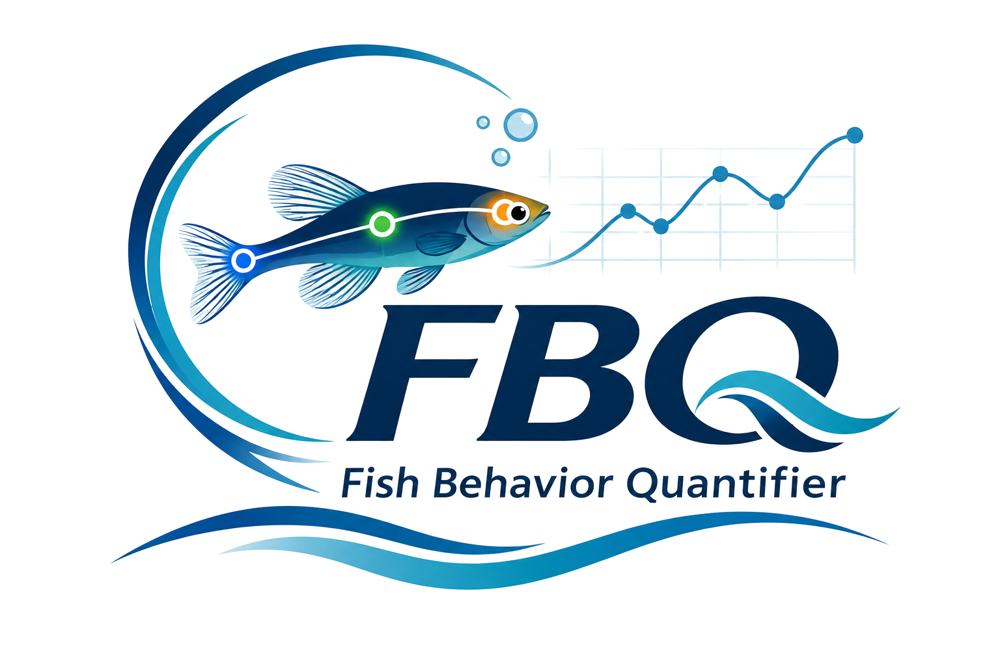

<p align="center">
  
</p>

<br>

---

# Fish Behavior Quantifier FBQ

**Annotation-free multi-fish tracking and behavior quantification for laboratory videos.**

FBQ is a markerless multi-fish tracking system for laboratory tank recordings. It estimates head, center, and tail keypoints for every fish while maintaining individual identities over time. **No manual training annotation and no physical marking is required** — the model learns directly from the videos you provide.

[](https://www.youtube.com/watch?v=6EdLrUhgD30)

**▶ Watch the complete tool demonstration on YouTube**
---

## Quick Start

| Platform | One-Line Install & Run |
|----------|------------------------|
| **Windows 10/11** | Double-click `FBQ.bat` |
| **macOS (Apple Silicon)** | Double-click `FBQ.command` |
| **Linux / WSL2** | Run `bash FBQ.sh` |

After first setup, use the desktop shortcut (Windows) or run `fbq` / `fq` in any terminal.

---

## System Requirements

| Component | Minimum | Recommended |
|-----------|---------|-------------|
| **GPU** | NVIDIA 4 GB VRAM | NVIDIA 8+ GB VRAM (RTX 3070/4070 or better) |
| **RAM** | 8 GB | 16+ GB |
| **Storage** | 10 GB free | 20+ GB free (SSD) |
| **OS** | Windows 10, macOS 12+, Ubuntu 20.04+ | Latest LTS |
| **Python** | 3.10–3.12 (managed automatically) | — |
| **CUDA** | 12.6+ (managed automatically) | 13.2+ for Blackwell GPUs |

**Supported GPUs:**
- **NVIDIA**: Maxwell (GTX 900) through Blackwell (RTX 50-series) on Windows/Linux
- **Apple Silicon**: M1/M2/M3 (Metal/MPS) on macOS
- **AMD**: ROCm 7.2+ on Linux (experimental)

---

## Installation Guide

### Windows (10/11)

1. **Download** the latest release ZIP from GitHub Releases
2. **Extract** to a folder (e.g., `C:\FBQ`)
3. **Double-click** `FBQ.bat`
4. **Wait** for first-time setup (5–10 minutes):
   - Downloads pinned `uv` package manager
   - Creates isolated Python 3.12 environment
   - Installs PyTorch matched to your GPU
   - Downloads checksum-verified FFmpeg
5. **Done!** A desktop shortcut is created automatically

**Troubleshooting Windows:**
- If SmartScreen blocks it: Click "More info" → "Run anyway"
- If CUDA errors: Ensure NVIDIA driver ≥ 528.33 (for CUDA 12) or ≥ 550 (for CUDA 13)
- Antivirus false positives: Add the FBQ folder to exclusions

### macOS (Apple Silicon M1/M2/M3)

1. **Download** the latest release ZIP
2. **Extract** to a folder (e.g., `~/FBQ`)
3. **Right-click** `FBQ.command` → **Open** (bypasses Gatekeeper on first run)
4. **Wait** for first-time setup (3–5 minutes):
   - Uses system Python 3.12
   - Installs PyTorch with MPS support
   - Downloads FFmpeg
5. **Done!** Run `fbq` from Terminal anytime

**Note:** Intel Macs are not supported. Use Linux or Windows instead.

### Linux (Ubuntu 20.04+, Debian 12+, Fedora 38+, Arch)

**Option A: Native (recommended for NVIDIA GPUs)**
```bash
# Install system dependencies
sudo apt update && sudo apt install -y python3.12 python3.12-venv git curl

# Clone and run
git clone https://github.com/your-org/FBQ.git
cd FBQ
bash FBQ.sh
```

**Option B: WSL2 (Windows users wanting Linux environment)**
```powershell
# In PowerShell as Administrator
wsl --install -d Ubuntu
# Then follow Option A inside Ubuntu
```

**Option C: CPU-only (no NVIDIA GPU)**
```bash
# Set environment variable before first run
export FBQ_TORCH_PROFILE=cpu
bash FBQ.sh
```

**Troubleshooting Linux:**
- NVIDIA drivers: `sudo ubuntu-drivers autoinstall` then reboot
- CUDA version: FBQ manages its own CUDA via PyTorch wheels — **do not** install system CUDA
- Wayland: If GUI issues, try `GDK_BACKEND=x11 bash FBQ.sh`

---

## First Launch — What to Expect

When you run FBQ for the first time:

1. **Splash screen** appears with the FBQ logo
2. **Setup runs** (only on first launch):
   - Creates virtual environment in `~/.fbq/venv/`
   - Installs all Python dependencies
   - Verifies GPU/CUDA compatibility
3. **Home window** opens with two primary workflows:
   - 🎯 **Train AI Model** — Build a custom detector from your videos
   - 📊 **Inference & Behavior Quantification** — Run trained models on new data

---

## Primary Workflows — Step by Step

### Workflow 1: Train AI Model 🎯
*Formerly "Easy Tracking" — Build a custom fish detector from scratch*

**When to use:** You have new videos of your fish species and need to create a tracking model.

#### Step 1: Prepare Your Videos
- Record from a **fixed camera** viewing the tank from above (top-down) or side
- Stable lighting, static background, sufficient contrast
- At least 30 seconds of footage with fish **separated** from each other
- Supported formats: `.mp4`, `.avi`, `.mov`, `.mkv`

#### Step 2: Launch "Train AI Model"
1. Click **"Train AI Model"** on the home screen
2. Click **"📁 Load Folder"** and select the folder containing your videos
   - All videos in the folder will be loaded
   - Session settings auto-load from `fbq_session_settings.json` if present
3. For each video, click **"ROI"** to draw regions of interest (tanks/arenas)
   - Use rectangle, circle, or grid shapes
   - Label each ROI (e.g., "Tank 1", "Tank 2")
   - Set expected fish count per ROI

#### Step 3: Configure Segmentation (Optional but Recommended)
1. Click **"Launch Segmentation"**
2. Adjust thresholds so each fish appears as a **single blob**
3. Mark unsuitable regions as "outliers"
4. Click **"Processing"** to generate training masks

#### Step 4: Run Training Pipeline
1. Back in "Train AI Model", verify:
   - Number of fish per ROI
   - Overlap severity (low/medium/high)
   - Backward swimming (yes/no)
2. Click **"Processing"** to start the full pipeline:
   - Initial tracking → Direction classification → Synthetic data generation → Detector training → Final tracking
3. **Wait** (10 minutes to several hours depending on video length and GPU)

#### Step 5: Review Results
- **Result video**: Annotated MP4 with OBBs, keypoints, heading arrows, trails, speed labels
- **Result CSV**: Per-frame data — `frame, track_id, class_name, cx, cy, w, h, angle, head_x, head_y, center_x, center_y, tail_x, tail_y, heading, speed, angular_velocity, acceleration`
- **Model weights**: Saved in `<session>/weights/` for later inference

---

### Workflow 2: Inference & Behavior Quantification 📊
*Run trained models on new videos and extract behavior metrics*

**When to use:** You have a trained model (from Workflow 1) and new videos to analyze.

#### Step 1: Prepare
- Have your **model session folder** ready (contains `weights/` and `config.yaml`)
- Have new **raw videos** to analyze (same recording conditions as training)

#### Step 2: Launch "Inference & Behavior Quantification"
1. Click **"Inference & Behavior Quantification"** on the home screen
2. **Model Session**: Click "Browse" and select your trained session folder
3. **Weights**: Select the `.pt` file (usually `best.pt` or `last.pt`)
4. **Output Directory**: Choose where to save results

#### Step 3: Add Videos & ROIs
1. Click **"📁 Load Folder"** and select folder with new videos
2. For each video, click **"ROI"** to draw the same tank/arena regions
   - **Important**: ROIs must match the positions from training
   - Labels should match (e.g., "Tank 1" → "Tank 1")

#### Step 4: Configure Keypoints & Analysis
- **Extract Head (snout)**: Leading end of movement
- **Extract Center (body centroid)**: OBB center
- **Extract Tail (caudal fin)**: Trailing end
- **Run Behavior Analysis**: Enables speed, acceleration, angular velocity

#### Step 5: Run Quantification
1. Click **"▶ Run Quantification"**
2. Progress bar shows: Detection → Tracking → Keypoint extraction → Behavior metrics
3. **Video playback controls** appear after completion:
   - Frame slider, ▶⏸ play/pause, ⏮⏭ step frame
   - Frame counter and timestamp display

#### Step 6: Extract Behavioral Endpoints (Advanced)
1. After tracking completes, **"Extract Behavioral Endpoints"** button enables
2. Click to open the **Endpoints Extraction** dialog:
   - **Global Parameters**: Pixel/cm calibration, FPS, speed thresholds
   - **View Type**: Side/Lateral View or Top View (changes available metrics)
   - **Division Rules**: Horizontal, vertical, or diagonal tank divisions
   - **Metrics Selection**: 13 metrics available (speed ratios, thigmotaxis, fractal dimension, entropy, body-length normalized)
   - **Pixel/cm Calibration**: Draw 2 points on known distance (ImageJ-style)
3. Click **"🚀 RUN ENDPOINTS EXTRACTION"**
4. Outputs:
   - `endpoints_summary.csv` — per-arena metrics
   - `endpoints_summary.xlsx` — Excel with per-video sheets
   - `endpoints_kinetics.csv` — frame-by-frame kinematics (optional)

---

## Optional Tools

Access via **"Optional Tools"** section on home screen:

| Tool | Purpose | When to Use |
|------|---------|-------------|
| **Segmentation** | Configure foreground/background masks | Before training, to optimize blob detection |
| **Cropping & Trimming** | Crop videos, trim frames | Pre-processing raw footage |
| **Advanced Tracking** | Full parameter control for every pipeline stage | Expert users, custom configurations |
| **Refinement** | Manual correction of tracking errors | Fix identity swaps, missed detections |
| **Multi Config Batch** | Run multiple saved configurations sequentially | Parameter sweeps, reproducibility |
| **Colab (beta)** | Package for Google Colab GPU runtime | Linux only, when local GPU unavailable |

---

## Understanding the Output

### Tracking CSV Columns
| Column | Description |
|--------|-------------|
| `frame` | Frame number (0-indexed) |
| `track_id` | Unique fish identity (e.g., `Tank1-ID3`) |
| `class_name` | Direction class (8-way: `upper`, `upper_right`, `right`, `lower_right`, `lower`, `lower_left`, `left`, `upper_left`) |
| `cx, cy` | OBB center coordinates (pixels) |
| `w, h` | OBB width, height (pixels) |
| `angle` | OBB rotation angle (degrees) |
| `head_x, head_y` | Head keypoint (snout) |
| `center_x, center_y` | Center keypoint (body centroid) |
| `tail_x, tail_y` | Tail keypoint (caudal fin) |
| `heading` | Head direction (degrees, 0° = right, CCW) |
| `speed` | Instantaneous speed (cm/s or px/frame) |
| `angular_velocity` | Rate of heading change (deg/s) |
| `acceleration` | Rate of speed change (cm/s²) |

### Endpoint Metrics (13 Total)
| Metric | Side View | Top View | Description |
|--------|-----------|----------|-------------|
| Average Speed (cm/s) | ✅ | ✅ | Mean swimming speed |
| Freezing Time Ratio (%) | ✅ | ✅ | % time below freeze threshold |
| Swimming Time Ratio (%) | ✅ | ✅ | % time in normal swim range |
| Rapid Movement Time Ratio (%) | ✅ | ✅ | % time above rapid threshold |
| Time in Top Percentage (%) | ✅ | ❌ | % time in upper tank region |
| Time in Bottom Percentage (%) | ✅ | ❌ | % time in lower tank region |
| Average Thigmotaxis (cm) | ✅ | ✅ | Mean distance to wall |
| Fractal Dimension | ✅ | ✅ | Path complexity (1–2) |
| Entropy | ✅ | ✅ | Movement unpredictability |
| Average Speed (body-length/s) | ✅ | ✅ | Speed normalized to fish size |
| Freezing Time Ratio (bl/s) (%) | ✅ | ✅ | Body-length normalized freezing |
| Swimming Time Ratio (bl/s) (%) | ✅ | ✅ | Body-length normalized swimming |
| Rapid Movement Ratio (bl/s) (%) | ✅ | ✅ | Body-length normalized rapid |

---

## Settings & Persistence

FBQ automatically saves settings to **`fbq_session_settings.json`** in the same folder as your videos. When you reload that folder, all settings restore:
- Model session & weights paths
- ROI definitions (positions, shapes, labels, fish counts)
- Display settings (arrow size, font sizes, trail length)
- Keypoint extraction options
- Endpoints extraction parameters (calibration, metrics, view type, divisions)

**Manual backup:** Copy the session folder to preserve everything.

---

## Directory Structure

```
FBQ/
├── FBQ.sh / FBQ.bat / FBQ.command    # Launchers
├── pyproject.toml                     # Dependencies
├── uv.lock                            # Pinned versions
├── VERSION                            # Version number
├── gui/                               # GUI applications
│   ├── gui_home.py                   # Home window (this redesign)
│   ├── gui_easy_tracking.py          # Train AI Model
│   ├── gui_behavior_quantification.py # Inference & Behavior
│   ├── gui_segmentation.py
│   ├── gui_advanced_tracking.py
│   ├── gui_refinement.py
│   ├── gui_preprocess.py
│   ├── gui_multi_config_batch.py
│   ├── gui_colab.py
│   └── assets/                        # Logos, icons
├── main/                              # Pipeline stages
│   ├── batch.py                      # Stage orchestrator
│   ├── initial_tracking.py
│   ├── direction_class_assignment.py
│   ├── interaction_image_synthesis*.py
│   ├── crop_images.py
│   ├── create_dataset.py
│   ├── obb_detector_training.py
│   ├── obb_detection.py
│   ├── multi_staged_association.py
│   ├── refinement.py
│   ├── create_video.py
│   ├── behavior_analysis.py
│   ├── endpoints_engine.py           # Behavioral metrics
│   └── ...
├── tools/                             # Utilities
│   ├── setup_environment.py
│   ├── settings_manager.py           # Session settings
│   └── project_meta.py               # Project identity
└── docs/                              # Documentation
    ├── MANUAL.md
    └── REDESIGN.md
```

---

## Troubleshooting

### Common Issues

| Problem | Solution |
|---------|----------|
| "CUDA out of memory" | Reduce video resolution, fewer fish, or use `FBQ_TORCH_PROFILE=cu126` |
| "No module named 'openpyxl'" | Run `bash FBQ.sh` again — it installs missing deps |
| Tracking loses identity | Increase overlap severity setting; use Refinement tool |
| Head/tail swapped | Check "Backward swimming" setting in Train AI Model |
| Slow inference | Ensure GPU is used (check console for "CUDA" not "CPU") |
| Mac: "App is damaged" | `xattr -cr FBQ.command` then right-click → Open |

### Logs & Diagnostics
- Console output shows: PyTorch version, GPU detected, pipeline progress
- Each stage logs to `<output>/logs/stage_name.log`
- Enable debug: `FBQ_DEBUG=1 bash FBQ.sh`

---

## Attribution and Upstream

FBQ is a derivative work of **AMADEUS — Annotation-free Multi-Animal Direction Estimation Using Self-supervised Learning**.

> Yusuke Notomi, Kentarou Matsumura, and Shigeto Dobata (2026).
> *AMADEUS: Annotation-free multi-animal direction estimation using self-supervised learning.* bioRxiv.
> https://doi.org/10.64898/2026.09.19.752854

The upstream project is by Yusuke Notomi at <https://github.com/jpmyrmecol/AMADEUS>. The original authors retain copyright in the code they wrote; every source file keeps its `SPDX-License-Identifier: AGPL-3.0-only` header and its original copyright line. **Please cite the upstream work when you publish results obtained with this software.**

---

## License

FBQ is distributed under the **GNU Affero General Public License v3.0 only** (`AGPL-3.0-only`). See [LICENSE](LICENSE) and [third-party notices](THIRD_PARTY_NOTICES.md).

**AGPL-3.0 §5 requires that modified versions convey their source to network users.** Any hosted or distributed FBQ build must ship the corresponding source code. The Colab runtime package carries a per-file SHA-256 manifest that records exactly which source a given run used — keep that mechanism intact.

---

## Community & Support

- **Bug reports**: [GitHub Issues](https://github.com/your-org/FBQ/issues) — use the bug report template
- **Feature requests**: [GitHub Issues](https://github.com/your-org/FBQ/issues) — use the feature request template
- **Questions**: [GitHub Discussions](https://github.com/your-org/FBQ/discussions)
- **Security issues**: Email `fbq-security@users.noreply.github.com` (see [SECURITY.md](SECURITY.md))
- **Accessibility**: See [ACCESSIBILITY.md](ACCESSIBILITY.md)

---

## Citation

If you use FBQ in your research, please cite:

```bibtex
@software{fbq2026,
  title = {FBQ — Fish Behavior Quantifier},
  author = {Mahmood Yousaf, Gilber AUdira, Dr. Chung Der Hsiao},
  year = {2026},
  url = {https://github.com/yousaf2018/Fish-Behavior-Quantifier},
}

@article{amadeus2026,
  title = {AMADEUS: Annotation-free multi-animal direction estimation using self-supervised learning},
  author = {Notomi, Yusuke and Matsumura, Kentarou and Dobata, Shigeto},
  journal = {bioRxiv},
  year = {2026},
  doi = {10.64898/2026.09.19.752854}
}
```

---

<p align="center">
  <strong>Built for fish behavior researchers, by fish behavior researchers.</strong>
</p>
